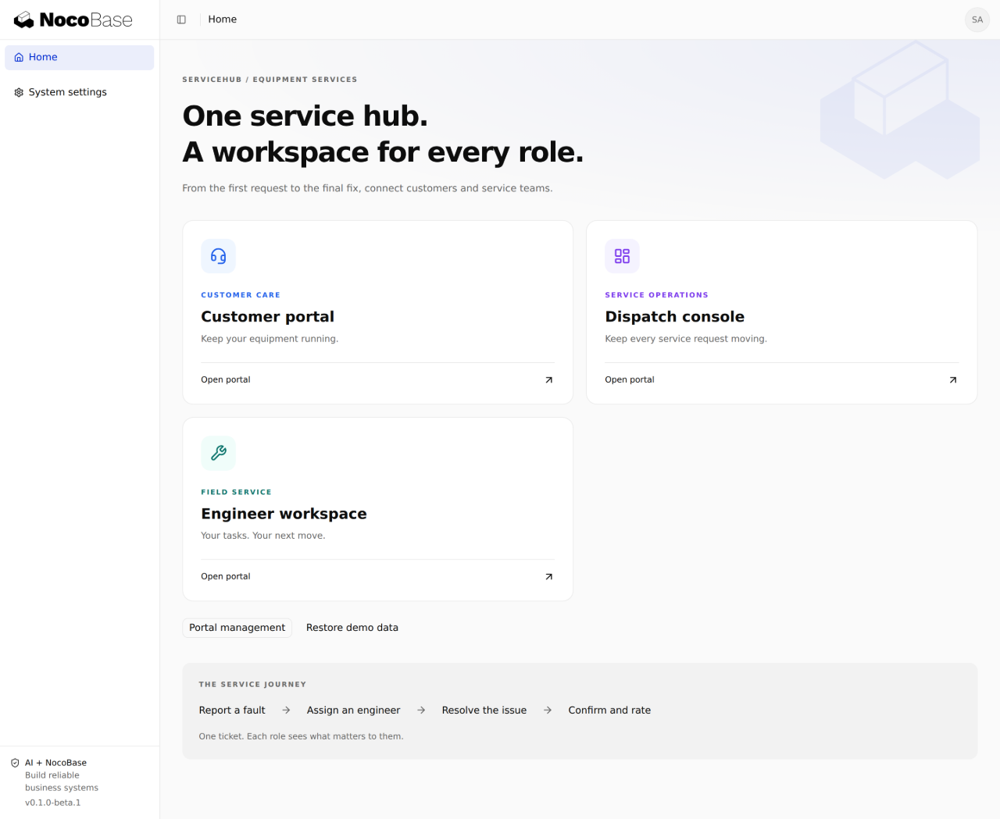
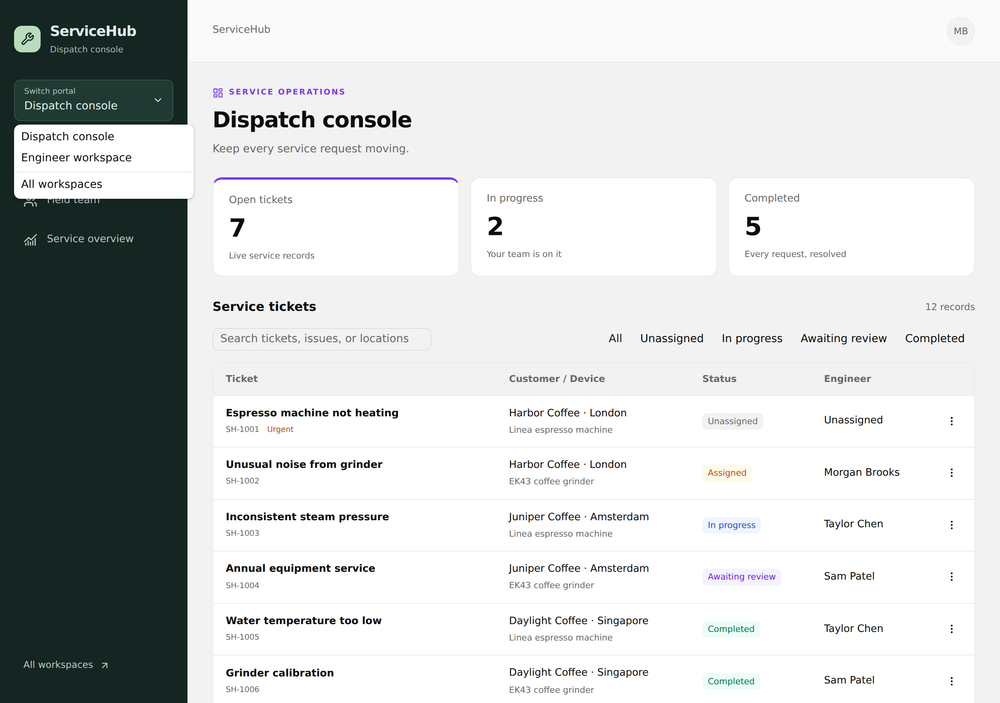
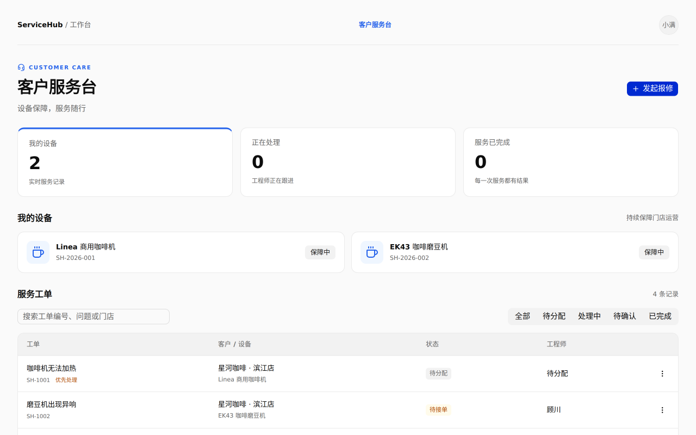
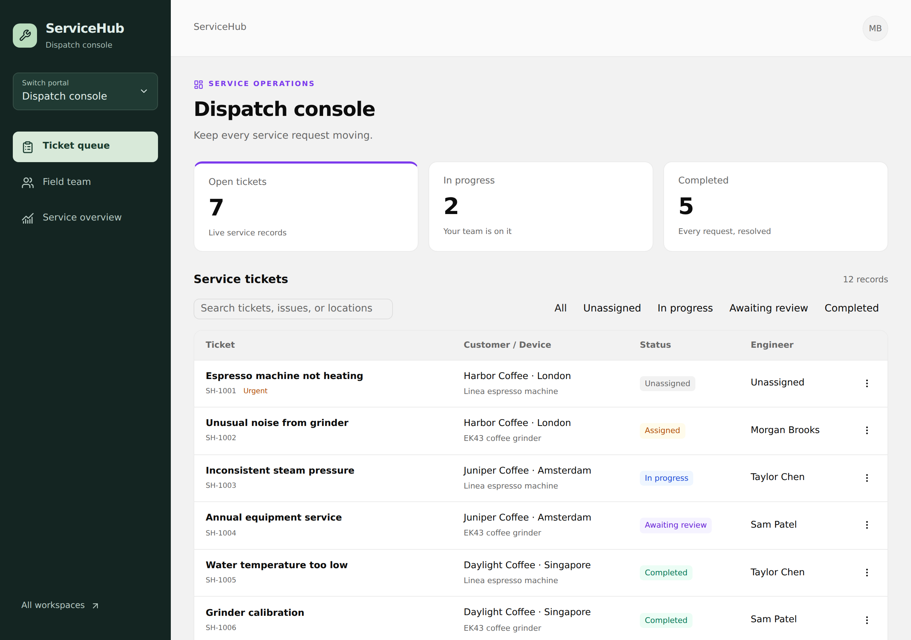
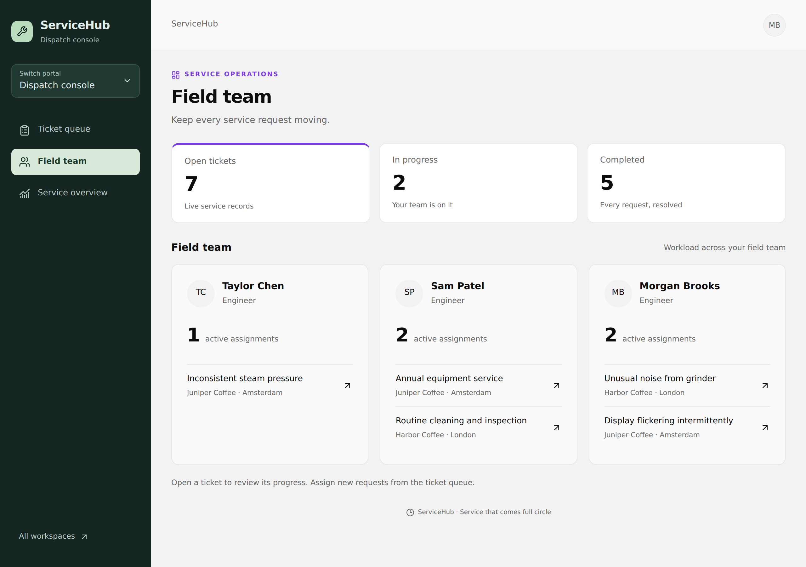
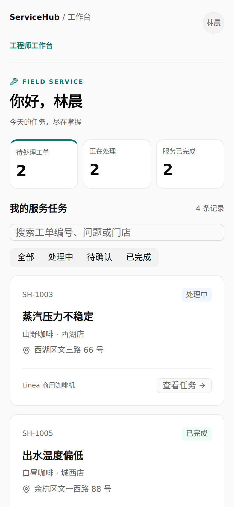
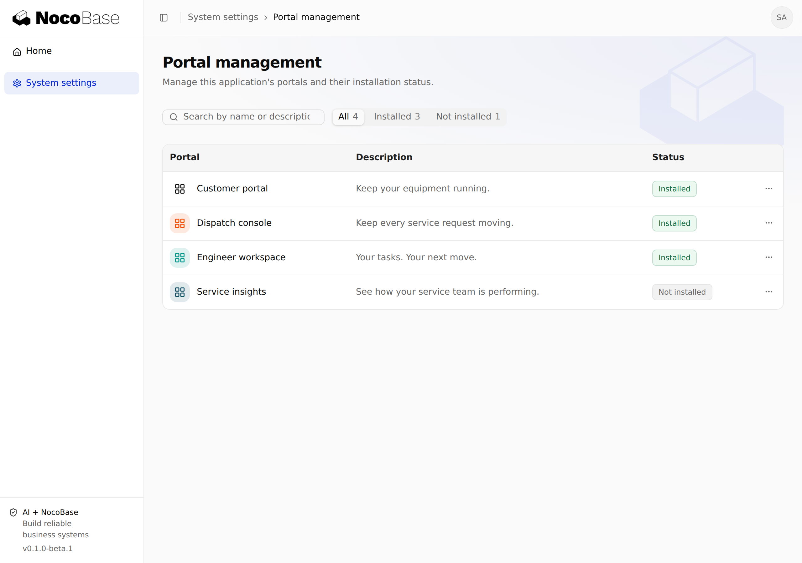

# Multi-portal Example — ServiceHub

English | [简体中文](README.zh-CN.md)

A NocoBase 3 example application demonstrating multiple portals, shared business data, role-based permissions, and cross-portal collaboration. ServiceHub brings these capabilities together in an equipment service scenario: customers, dispatchers, and engineers work on the same ticket through dedicated portals.



- **One account, multiple workspaces:** switch between dispatch and field service without signing out.
- **A layout for each job:** customer top navigation, a dispatch sidebar, and an engineer workspace with mobile bottom navigation.
- **One shared service process:** report, assign, resolve, and confirm the same ticket with role-scoped data and actions.
- **Independent portal installation:** enable Service insights when needed; only authorized users see its entry.

[Installation](#installation) · [Demo accounts](#demo-accounts) · [Portal switching](#show-the-multi-portal-experience-first) · [Walkthrough](#five-minute-walkthrough) · [Screenshots](#usage-guide-and-screenshots)

## Installation

### 1. Prerequisites

- Node.js **24 or later**.
- pnpm **11.7.0**.
- Git and access to the `nocobase/app-example-multi-portal` repository.
- Read access to the NocoBase private package registry. This application uses the commercial multi-portal plugin.

The default database is SQLite; no separate database service is required.

```bash
node --version
npm install -g pnpm@11.7.0
pnpm --version
```

### 2. Clone the repository

```bash
git clone https://github.com/nocobase/app-example-multi-portal.git
cd app-example-multi-portal
```

Install this repository directly. You do not need to generate another application with `create-app`.

### 3. Configure the registry and install dependencies

Sign in to the NocoBase private registry with an account that has read access:

```bash
pnpm login --registry=https://pkg-v3.nocobase.com/ --scope=@nocobase
```

Enter your account details when prompted, using the registry's read token (`nbr_…`) as the password. This configures the `@nocobase` scope in your user-level configuration; other dependencies continue to use the default npm registry. Do not commit the token.

```bash
pnpm config get @nocobase:registry
# Expected: https://pkg-v3.nocobase.com/

pnpm install
```

The private registry serves both commercial and open-source `@nocobase` packages. If an error references `registry.npmjs.org/@nocobase/app-plugin-multi-portal`, check the scoped registry configuration first.

## Initialize the demo

Complete these steps before starting a new installation for the first time.

### 1. Generate the configuration

```bash
pnpm nocobase config init --dialect sqlite
```

This creates a local `config.yml` and initializes its encryption keys. Do not use the placeholder key from [config.example.yml](config.example.yml).

There are three separate types of credentials:

| Credential                               | Purpose                                                                         |
| ---------------------------------------- | ------------------------------------------------------------------------------- |
| Registry read token                      | Download NocoBase dependencies                                                  |
| `secrets.keys` in `config.yml`           | Encrypt stored sensitive information and derive authentication and session keys |
| Administrator and demo account passwords | Sign in to ServiceHub                                                           |

`config.yml` is ignored by Git. Preserve the original keys when migrating an existing database; generate new keys for a separate demo installation.

### 2. Enable sample data

```bash
pnpm nocobase config set app.sampleData=true
pnpm nocobase config set client.app.title=ServiceHub i18n.defaultLocale=en-US client.app.defaultTheme=compact
pnpm nocobase config check
```

English is the default interface language. Chinese remains available from the language menu. Both languages use the same fictional English demo dataset, with locations in London, Amsterdam, and Singapore; addresses are illustrative, and opening hours use each location's local time.

On first startup, migrations and seeds automatically create the demo roles, 7 business accounts, 6 devices, and 12 tickets. The sample data covers 3 coffee shops and several stages of the service process.

The initial administrator is configured under `users.initialAdmin` in `config.yml`:

- Username: `nocobase`
- Email: `admin@nocobase.com` (also accepted at sign-in)
- Initial password: `admin123`

Change this configuration before the first startup if you want different initial credentials. Once an account exists, editing these values does not reset it or its password. Demo passwords are public test credentials; use them only in an isolated demo environment.

## Start the application

```bash
pnpm dev
```

Open the application URL printed in the terminal's ready message, including its full path (`/main/` by default). Do not use Vite's internal port as the application entry point.

For access from a phone or another device on your LAN, run this on macOS or Linux:

```bash
APP_SERVER_HOST=0.0.0.0 pnpm dev
```

Use the machine's actual LAN IP and the application port from the ready message. For a temporary public tunnel, forward the application entry port, preserve the application path, and add the public origin to `auth.trustedOrigins`. Configure `APP_ALLOWED_HOSTS` as needed in development. A temporary public URL expires when its tunnel stops.

## Prepare the portals

Sign in as the administrator, open **System settings → Portal management**, and install the first three business portals. Their code is included in the repository; installation enables each portal.

| Portal             | Demo role                          | Main features                                            | State to prepare  |
| ------------------ | ---------------------------------- | -------------------------------------------------------- | ----------------- |
| Customer portal    | Customer                           | Devices, repair requests, progress, service confirmation | Installed         |
| Dispatch console   | Dispatcher                         | Ticket overview, engineer assignment, service tracking   | Installed         |
| Engineer workspace | Engineer                           | Assigned tasks, acceptance, resolution reporting         | Installed         |
| Service insights   | Manager; administrator installs it | Live status and location summaries                       | Leave uninstalled |

Return to the home workbench to enter installed portals that your account can access. Installation and business permissions are separate requirements; installing a portal does not automatically grant access to every user.

## Demo accounts

All business accounts below use **`ServiceHub2026!`** as their password. Sign in with either the username or email.

| Role                                   | Name          | Username     | Email                           |
| -------------------------------------- | ------------- | ------------ | ------------------------------- |
| Customer · Harbor Coffee · London      | Alex Morgan   | `customer1`  | `customer-1@servicehub.example` |
| Customer · Juniper Coffee · Amsterdam  | Sofia Rivera  | `customer2`  | `customer-2@servicehub.example` |
| Customer · Daylight Coffee · Singapore | Jamie Park    | `customer3`  | `customer-3@servicehub.example` |
| Dispatcher                             | Jordan Lee    | `dispatcher` | `dispatcher@servicehub.example` |
| Engineer                               | Taylor Chen   | `engineer1`  | `engineer-1@servicehub.example` |
| Engineer                               | Sam Patel     | `engineer2`  | `engineer-2@servicehub.example` |
| Service manager                        | Morgan Brooks | `manager`    | `manager@servicehub.example`    |

Customers access their own devices and tickets; engineers handle their assigned tasks; the dispatcher assigns tickets across customers. Use `manager` to demonstrate switching portals within one session. For collaboration between different people, use separate browser profiles; regular tabs in the same browser share a login session.

## Show the multi-portal experience first

Start with **`manager` / `ServiceHub2026!`**. Morgan Brooks coordinates the team and handles field work, with two assigned tasks ready to demonstrate. This account has no customer or system administration permissions.



1. Open **Dispatch console**. Use its sidebar to explore **Ticket queue**, **Field team**, and **Service overview**. Team assignments and status/location summaries use the actual tickets.
2. Choose **Switch portal → Engineer workspace**. Without signing out, the same account enters its own field tasks. The sidebar gives way to task cards and mobile bottom navigation.
3. Open **Completed work** from the bottom navigation to view finished tasks; it starts empty for the manager and fills as customers confirm completed work. Switch back to the dispatch portal to see all customers and team assignments again.
4. Sign in as `customer1` to show the customer portal's top navigation: **Overview**, **My devices**, and **Service tickets**. Report a fault directly from a device on the devices page.

| Portal             | Independent layout                             | Working pages                                     |
| ------------------ | ---------------------------------------------- | ------------------------------------------------- |
| Customer portal    | Top navigation and a customer welcome area     | Overview, devices, requests                       |
| Dispatch console   | Dark sidebar and a wide operations workspace   | Ticket queue, field team, service overview        |
| Engineer workspace | Focused task cards and fixed bottom navigation | My tasks, completed work                          |
| Service insights   | Analytics sidebar and live summaries           | Status distribution, service progress by location |

The switcher lists only portals that are **installed and authorized for the current account**. The manager sees all tickets in dispatch and only personal assignments in the engineer portal. Layout and data scope change together. After an administrator installs Service insights, it also appears in the manager's switcher.

## Five-minute walkthrough

Use two browser profiles: one for `customer1`, the other for `manager`. Install the first three portals before starting.

1. **Report:** as `customer1`, open **My devices** and report a fault on the Linea espresso machine. Use “Espresso machine not heating” as the title and note the new ticket ID.
2. **Dispatch:** as `manager`, open **Dispatch console → Ticket queue**, find that ID, and assign it to **Morgan Brooks**. Open **Field team** to see the assignment under the manager.
3. **Switch and resolve:** choose **Switch portal → Engineer workspace** without signing out. Open the same ticket, select **Accept and start**, enter a resolution, and select **Submit resolution**.
4. **Confirm:** return to the customer's browser profile, open **Service tickets → Awaiting review**, and confirm and rate the service. In the manager's engineer portal, refresh and open **Completed work** to see the finished ticket.
5. **Show an extension:** sign in as the administrator in a separate profile and install **Service insights**. Refresh the manager's page and open it through **Switch portal** to inspect live service summaries. Uninstall it afterward to restore the initial three-portal setup.

This sequence demonstrates one ticket moving between people, and one person switching between two distinct workspaces. For a separate dispatcher/engineer presentation, use `dispatcher` to assign the ticket to **Taylor Chen**, then `engineer1` to handle it.

Customer and dispatch portals use responsive tables with actions collected in a text-only more menu. The engineer portal uses task cards and bottom navigation. Portal switching preserves the signed-in identity; the server enforces each portal's permissions and data scope.

## Usage guide and screenshots

These screenshots show the running demo with fictional accounts and sample records. They show different preloaded tickets, rather than consecutive states of one newly created ticket. Counts change as you use the application.

### Customers: report a fault and track progress

Sign in as `customer1` and enter **Customer portal**. The top navigation separates **Overview**, **My devices**, and **Service tickets**. Overview includes a welcome area, statistics, and device summaries; the devices page includes a fault-report shortcut for each device.



1. Click **Report a fault** in the page header and select the device, or use the action on **My devices** to preselect that device.
2. Enter a title, description, and urgency. For example: “Coffee machine not heating”; “The water temperature has stayed low since opening this morning, even after restarting.”
3. Click **Submit request**. The ticket appears as **Unassigned**. Note its ID for the following steps.
4. Click the ticket title or **View details** in the row's more menu to see the device, engineer, description, and progress.

Search by ticket ID, issue, or shop, or filter by status. Customers see only their own data; switch to `customer2` to demonstrate customer data isolation.

### Dispatchers: assign an engineer

Sign in as `dispatcher` or `manager` and enter **Dispatch console**. This portal brings together tickets from different customers for service coordination. The screenshots use the manager account.



Use **Field team** to inspect workload and open an assigned ticket directly. **Service overview** summarizes the same tickets by status and location.



1. Open **Ticket queue**, then search for the ticket ID or select **Unassigned**.
2. Open its details, or choose **Assign engineer** from the row's more menu.
3. Select **Taylor Chen** in the engineer field and submit the assignment.
4. The ticket becomes **Assigned** and displays Taylor Chen as its engineer.

Continue with `engineer1`. If you assign the ticket to Sam Patel, use `engineer2` instead.

### Engineers: accept a task and report the resolution

Sign in as `engineer1` and enter **Engineer workspace**. Task cards show the assigned ticket, customer, address, device, and status. The same operations are available on mobile.

The screenshot uses the manager account after switching into field work. Completed tasks have their own **Completed work** page in the bottom navigation.



1. Find the newly assigned task under **All** and click **View task**.
2. Click **Accept and start** in its details. The status becomes **In progress**.
3. After completing the work, reopen the task and enter the **Resolution**. For example: “Descaled the heating element, replaced the temperature sensor, and confirmed normal water temperature during a test run.”
4. Click **Submit resolution**. The status becomes **Awaiting review**.

Actions appear only for tasks assigned to the current engineer and in the appropriate state. If a task is missing, switch back to All and check which engineer the dispatcher selected.

### Customers: confirm and rate the service

Return to `customer1`'s customer portal. Refresh the page if needed to load the latest status.

1. Select **Awaiting review** and find the ticket.
2. Open its details and read the engineer's resolution.
3. Select a rating and submit the confirmation. You can also enter through **Confirm and rate** in the row's menu.
4. The ticket becomes **Completed**, retaining its resolution and rating.

The full sequence is **Unassigned → Assigned → In progress → Awaiting review → Completed**. Available actions depend on the role and current state; preceding steps cannot be skipped.

### Administrators: manage portals and repeat the demo

Sign in with the initial administrator account (default username: `nocobase`). The home workbench shows the installed portals available to the administrator, along with **Portal management** and **Restore demo data**.

Open **System settings → Portal management** and use each row's more menu to install, open, or uninstall a portal. Install Service insights to show its new workbench entry, then uninstall it to hide the entry.

The screenshot below shows three installed business portals and Service insights left uninstalled for the extension demonstration.



Before another walkthrough, use **Restore demo data** on the workbench. This removes tickets created during the walkthrough and recreates the sample business data. Accounts, roles, and portal installation states remain unchanged; see the next section for details.

## Restore demo data

As the administrator, click **Restore demo data** on the home workbench and confirm. This replaces the demo devices, tickets, and processing records with the initial dataset of 12 tickets.

- Accounts, roles, and portal installation states are preserved.
- Restoration requires `app.sampleData` to be enabled.
- This operation does not recreate missing demo accounts or roles.

If sample data was disabled during the first initialization, stop the development server and run:

```bash
pnpm nocobase config set app.sampleData=true
pnpm nocobase db sample
pnpm dev
```

`db sample` runs previously skipped sample initialization in development; production deployments reject it. Do not clear the entire database just to reset a walkthrough.

## Troubleshooting

### Dependency installation returns 401, 403, or 404

Check that the `@nocobase` scope points to `https://pkg-v3.nocobase.com/` and that your read token is valid and authorized for the packages. A commercial package returning 404 on npmjs does not mean it is unpublished in the private registry.

### Configuration keys are missing

For a new installation, run `pnpm nocobase config init --dialect sqlite`, then `pnpm nocobase config check`. For an existing database, restore the original `config.yml` or key configuration rather than replacing its keys arbitrarily.

### Sign-in works, but business portals are missing

Ask the administrator to confirm that the portal is installed and the user has the appropriate role. Newly registered accounts do not automatically receive demo roles. Use a demo account or explicitly assign a role through user and permission management.

### Demo accounts are missing or their passwords do not work

Check that `app.sampleData` was enabled before initialization. If sample initialization was skipped, follow the `db sample` steps above. The administrator uses a different password from the business demo accounts; existing installations retain their actual account settings.

### The default language or theme does not change

Saved browser preferences take precedence over configuration defaults. Change the language or theme through the interface, or use a new browser profile to see the defaults.

## Development and deployment

Business pages live in [client/pages/servicehub](client/pages/servicehub), API routes in [server/routes/servicehub.ts](server/routes/servicehub.ts), and seed data in [database/main/seeds](database/main/seeds). The four portal packages are under [packages](packages).

| Command          | Purpose                                            |
| ---------------- | -------------------------------------------------- |
| `pnpm dev`       | Start the development server                       |
| `pnpm typecheck` | Check client, server, and tooling types            |
| `pnpm test`      | Run automated tests                                |
| `pnpm build`     | Build the application and its runtime dependencies |
| `pnpm start`     | Start the built application                        |

Production deployment requires separate configuration, persistent storage, and registry credentials. See [build and deployment notes](.agents/rules/build-and-deploy.md). [scripts/start-demo.sh](scripts/start-demo.sh) is a maintenance script for the existing Linux demo host; it depends on that host's service configuration and a built frontend. For a new installation, use the `pnpm dev` instructions above.

Role collaboration, permission checks, and frontend compilation have been verified. Independent dependency resolution with the private registry has also passed. A complete clean installation and a portable production bundle have not yet been verified end to end. The repository does not currently include a dependency lockfile, so installation at different times may resolve different compatible versions.
