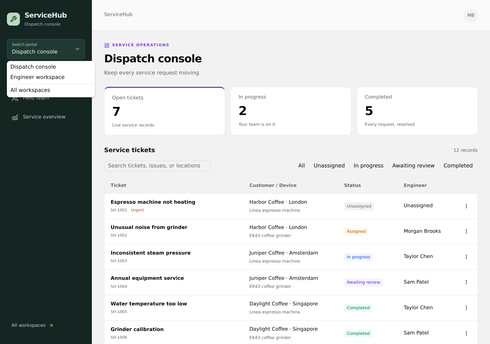
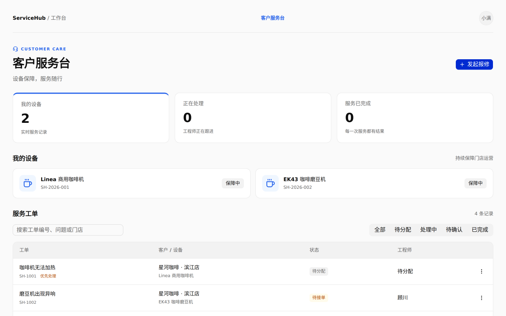
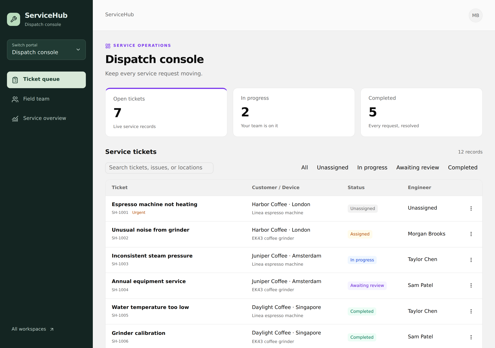
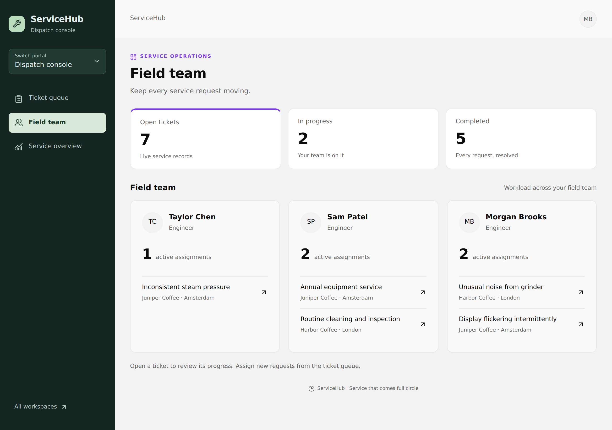
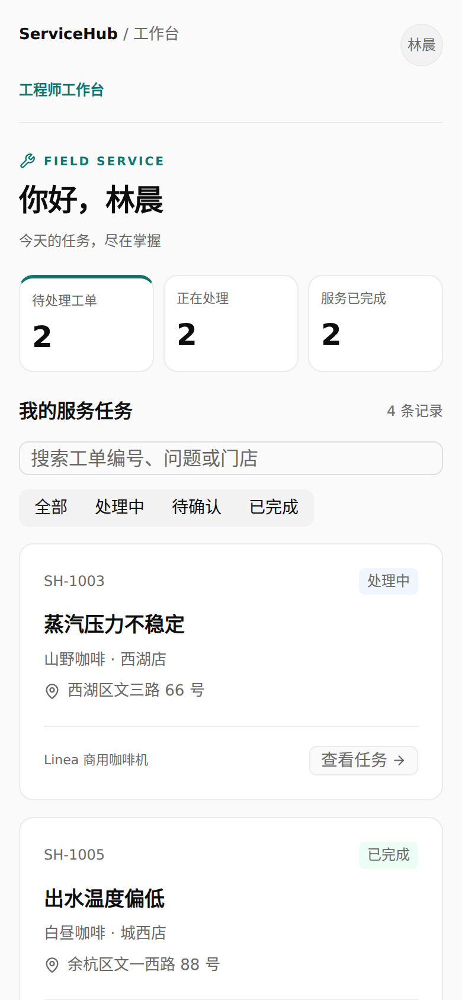
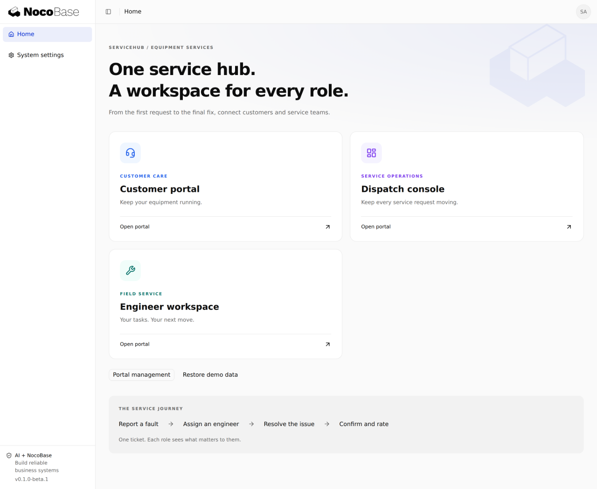
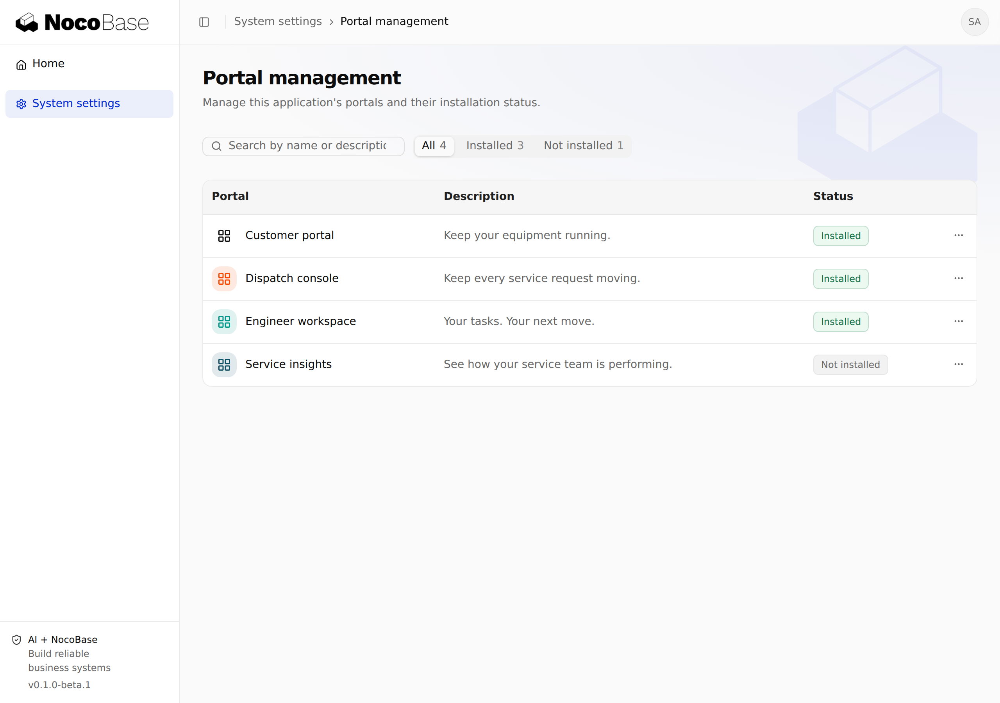

# 多门户示例 — ServiceHub

[English](README.MD) | 简体中文

基于 NocoBase 3 的多门户示例应用，展示共享业务数据、角色权限和跨门户协作。ServiceHub 以设备服务为业务场景，让客户、调度员和工程师通过各自的门户，围绕同一张工单完成协作。



- **一个账号，多个工作台**：无需退出登录，即可在调度和现场服务之间切换。
- **不同门户，独立布局**：客户顶部导航、调度侧边栏、工程师移动端底部导航。
- **共享完整服务流程**：围绕同一张工单报修、派单、处理和确认，各角色的数据范围与操作权限不同。
- **门户独立安装**：按需启用 Service insights，只有获得授权的用户才会看到入口。

[安装](#安装) · [演示账号](#演示账号) · [门户切换](#先展示多门户特色) · [演示流程](#五分钟演示流程) · [实际截图](#使用说明与截图)

## 安装

### 1. 准备环境

- Node.js **24 或更高版本**。
- pnpm **11.7.0**。
- Git，以及 `nocobase/app-example-multi-portal` 仓库的访问权限。
- NocoBase 私有包源的读取权限：本项目使用商业多门户插件。

默认使用 SQLite，无需单独安装数据库服务。

```bash
node --version
npm install -g pnpm@11.7.0
pnpm --version
```

### 2. 克隆仓库

```bash
git clone https://github.com/nocobase/app-example-multi-portal.git
cd app-example-multi-portal
```

直接安装这个仓库即可，不需要再通过 `create-app` 创建应用。

### 3. 配置包源并安装依赖

使用具有读取权限的账号登录 NocoBase 私有包源：

```bash
pnpm login --registry=https://pkg-v3.nocobase.com/ --scope=@nocobase
```

按提示输入账号信息，密码使用私有包源提供的读取令牌（`nbr_…`）。此操作会在用户级配置中设置 `@nocobase` 的包源；其他依赖仍使用默认 npm 源。不要把令牌写进仓库。

```bash
pnpm config get @nocobase:registry
# 应输出 https://pkg-v3.nocobase.com/

pnpm install
```

私有源同时提供商业包和开源 `@nocobase` 包。若错误信息指向 `registry.npmjs.org/@nocobase/app-plugin-multi-portal`，先检查作用域包源配置。

## 初始化 Demo

以下步骤用于新安装的应用，须在第一次启动前完成。

### 1. 生成配置

```bash
pnpm nocobase config init --dialect sqlite
```

命令生成本机的 `config.yml`，并初始化配置密钥。不要直接使用 [config.example.yml](config.example.yml) 中的占位密钥。

这里涉及三类不同凭据：

| 凭据                             | 用途                                             |
| -------------------------------- | ------------------------------------------------ |
| 包源读取令牌                     | 下载 NocoBase 依赖                               |
| `config.yml` 中的 `secrets.keys` | 加密应用保存的敏感信息，并用于派生登录和会话密钥 |
| 管理员及演示账号密码             | 登录 ServiceHub                                  |

`config.yml` 已被 Git 忽略。迁移已有数据库时应保留原配置密钥；新建独立 Demo 时生成自己的密钥。

### 2. 开启演示数据

```bash
pnpm nocobase config set app.sampleData=true
pnpm nocobase config set client.app.title=ServiceHub i18n.defaultLocale=en-US client.app.defaultTheme=compact
pnpm nocobase config check
```

默认界面为英文，可通过语言菜单切换中文。两种语言共用一套英文示例数据，门店分布在伦敦、阿姆斯特丹和新加坡；人名、门店和地址均为虚构，营业时间采用门店当地时间。

首次启动会自动执行数据库迁移和种子数据，创建演示角色、7 个业务账号、6 台设备及 12 张工单。演示数据对应 3 家咖啡门店，覆盖报修、派单、处理和确认等状态。

默认初始管理员在 `config.yml` 的 `users.initialAdmin` 中配置：

- 用户名：`nocobase`
- 邮箱：`admin@nocobase.com`（也可用于登录）
- 初始密码：`admin123`

如需修改初始管理员，请在首次启动前修改配置。数据库已有账号后，修改这段配置不会重置账号或密码。演示账号使用公开的测试密码，请只在隔离的演示环境中使用。

## 启动应用

```bash
pnpm dev
```

打开终端就绪信息中打印的应用 URL，保留完整路径（默认包含 `/main/`）。不要使用 Vite 的内部端口作为应用入口。

需要手机或其他局域网设备访问时，可在 macOS / Linux 中运行：

```bash
APP_SERVER_HOST=0.0.0.0 pnpm dev
```

使用本机实际局域网 IP 和就绪信息中的应用端口访问。通过临时公网隧道演示时，将隧道指向应用入口端口，保留应用路径，并将公网来源加入 `auth.trustedOrigins`；开发模式按需配置 `APP_ALLOWED_HOSTS`。临时公网地址随隧道停止而失效。

## 准备门户

管理员登录后，进入 **系统设置 → 门户管理（Portal management）**，安装前三个业务门户。门户代码已随仓库提供，安装操作会启用对应门户。

| 门户               | 演示角色             | 主要内容                               | 演示前状态 |
| ------------------ | -------------------- | -------------------------------------- | ---------- |
| Customer portal    | 客户                 | 我的设备、发起报修、进度查询、服务确认 | 已安装     |
| Dispatch console   | 调度员               | 工单总览、分配工程师、跟踪服务进度     | 已安装     |
| Engineer workspace | 工程师               | 分配给我的任务、接单、填写处理结果     | 已安装     |
| Service insights   | 经理使用，管理员安装 | 实时状态分布与门店服务进度             | 保留未安装 |

回到首页工作台即可进入已安装且有权访问的门户。门户是否安装和账号是否有业务权限是两个独立条件；安装门户不会给所有用户自动授权。

## 演示账号

以下业务账号密码统一为 **`ServiceHub2026!`**。用户名或邮箱均可用于登录。

| 角色                               | 姓名          | 用户名       | 邮箱                            |
| ---------------------------------- | ------------- | ------------ | ------------------------------- |
| 客户 · Harbor Coffee · London      | Alex Morgan   | `customer1`  | `customer-1@servicehub.example` |
| 客户 · Juniper Coffee · Amsterdam  | Sofia Rivera  | `customer2`  | `customer-2@servicehub.example` |
| 客户 · Daylight Coffee · Singapore | Jamie Park    | `customer3`  | `customer-3@servicehub.example` |
| 调度员                             | Jordan Lee    | `dispatcher` | `dispatcher@servicehub.example` |
| 工程师                             | Taylor Chen   | `engineer1`  | `engineer-1@servicehub.example` |
| 工程师                             | Sam Patel     | `engineer2`  | `engineer-2@servicehub.example` |
| 服务经理                           | Morgan Brooks | `manager`    | `manager@servicehub.example`    |

客户只访问自己的设备和工单，工程师处理分配给自己的任务，调度员负责跨客户派单。用 `manager` 展示同一会话内的门户切换。展示不同人员之间的协作时，使用不同浏览器配置文件分别登录；同一浏览器的普通标签页共享登录会话。

## 先展示多门户特色

先用 **`manager` / `ServiceHub2026!`** 登录。Morgan Brooks 同时负责调度和现场服务，有自己的两张待处理任务；这个账号没有客户权限或系统管理权限。

1. 进入 **Dispatch console**，使用左侧导航查看 **Ticket queue**、**Field team** 和 **Service overview**。团队页展示真实派单情况，总览按工单状态和门店汇总。
2. 点击 **Switch portal → Engineer workspace**。无需退出登录，同一账号立即进入自己的现场任务，页面从侧边栏切换为适合手机使用的任务卡片与底部导航。
3. 从底部 **Completed work** 查看已完成任务；经理初始没有已完成任务，客户确认服务后会出现在这里。再通过 **Switch portal** 返回调度门户，查看全部客户工单与团队分工。
4. 用 `customer1` 登录，展示客户门户的顶部导航：**Overview**、**My devices**、**Service tickets**。设备页可直接针对某台设备发起报修。

| 门户               | 独立布局                   | 可浏览的真实页面             |
| ------------------ | -------------------------- | ---------------------------- |
| Customer portal    | 顶部横向导航、客户欢迎区   | 概览、设备、服务请求         |
| Dispatch console   | 深色侧边栏、宽屏工作区     | 工单队列、现场团队、服务总览 |
| Engineer workspace | 窄屏任务卡片、固定底部导航 | 我的任务、已完成任务         |
| Service insights   | 分析侧边栏、汇总图表       | 工单状态分布、门店服务进度   |

切换菜单只列出**已安装且当前账号有权访问**的门户。经理在调度门户看到全部工单，在工程师门户只看到派给自己的任务；页面布局和数据范围一起变化。Service insights 由管理员安装后，也会出现在经理的切换菜单中。

## 五分钟演示流程

准备两个浏览器配置文件，分别登录 `customer1` 和 `manager`。开始前先安装前三个业务门户。

1. **客户报修**：用 `customer1` 打开 **My devices**，为 Linea espresso machine 发起报修。标题使用“Espresso machine not heating”，记下新工单编号。
2. **经理派单**：用 `manager` 打开 **Dispatch console → Ticket queue**，找到该编号，分配给 **Morgan Brooks**。进入 **Field team**，可以看到经理名下新增的任务。
3. **切换并处理**：无需退出登录，点击 **Switch portal → Engineer workspace**，打开同一张工单。点击 **Accept and start**，填写处理结果，再点击 **Submit resolution**。
4. **客户确认**：回到客户的浏览器配置文件，进入 **Service tickets → Awaiting review**，确认服务并评价。在经理的工程师门户刷新页面，进入 **Completed work** 查看这张已完成工单。
5. **展示门户扩展**：在单独的浏览器配置文件中以管理员登录，安装 **Service insights**。刷新经理页面，从 **Switch portal** 进入服务分析，查看实时汇总；演示后卸载它，恢复最初的三个门户配置。

这条流程同时展示一张工单在不同人员之间的协作，以及同一个人在两种工作台之间的切换。如需分开演示调度员和工程师，可改用 `dispatcher` 将工单分配给 **Taylor Chen**，再用 `engineer1` 处理。

客户与调度门户使用响应式表格，操作集中在纯文字的更多菜单中；工程师门户使用任务卡片和底部导航。切换门户保持当前登录身份，服务端独立校验各门户的权限与数据范围。

## 使用说明与截图

以下截图来自实际运行的 Demo，使用预置的虚构账号和业务数据。截图展示初始数据中的不同工单，不是同一张新建工单的连续状态；实际数量会随操作变化。

### 客户：报修与查询进度

使用 `customer1` 登录并进入 **Customer portal**。顶部导航区分 **Overview**、**My devices** 和 **Service tickets**。概览展示欢迎区、统计和设备摘要；设备页面为每台设备提供直接报修入口。



1. 点击页面标题区的 **Report a fault** 并选择设备，或从 **My devices** 中直接点击某台设备的报修按钮，自动选中该设备。
2. 填写问题标题和详细描述，选择紧急程度。例如标题“Espresso machine not heating”，描述“今天开店后水温一直偏低，重启后仍无法正常加热”。
3. 点击 **Submit request**。成功后工单出现在列表，状态为 **Unassigned**，记下工单编号供后续演示查找。
4. 点击工单标题，或行末更多菜单中的 **View details**，查看设备、工程师、问题描述和处理进度。

可以按工单编号、问题或门店搜索，也可切换状态筛选。客户账号只能看到自己的数据；切换到 `customer2` 可以展示不同客户间的数据隔离。

### 调度员：分配工程师

使用 `dispatcher` 或 `manager` 登录并进入 **Dispatch console**。这里汇总不同客户的服务工单，适合统一查看状态和安排服务人员。下方截图使用经理账号。



通过 **Field team** 查看工作量并直接打开已派工单；**Service overview** 按状态和门店汇总同一批工单。



1. 先进入 **Ticket queue**，再搜索刚才记录的工单编号，或切换 **Unassigned** 筛选。
2. 打开工单详情，也可以从行末更多菜单选择 **Assign engineer**。
3. 在详情中的工程师选择框选择 **Taylor Chen**，提交分配。
4. 分配成功后，工单变为 **Assigned**，工程师字段显示 Taylor Chen。

后续用 `engineer1` 跟进这张工单。若分配给 Sam Patel，则应使用 `engineer2` 登录。

### 工程师：接单与提交结果

使用 `engineer1` 登录 **Engineer workspace**。任务卡片显示分配给当前工程师的工单、客户、地址、设备和状态；手机端也能完成操作。下图使用经理账号，演示同一账号切换后的现场视角。已完成任务单独放在底部的 Completed work 页面。



1. 在 **All** 中找到新分配的任务，点击 **View task**。
2. 在详情中点击 **Accept and start**，状态变为 **In progress**。
3. 处理完成后再次打开任务，填写 **Resolution**，例如“清理加热管水垢，更换温度传感器，试运行后水温恢复正常”。
4. 点击 **Submit resolution**，状态变为 **Awaiting review**，等待客户确认。

只有分配给当前工程师且状态允许的任务，才会出现相应操作。找不到任务时，先切回“全部”，再确认调度员分配的工程师账号。

### 客户：确认并评价

回到 `customer1` 的客户服务台，必要时刷新页面获取最新状态。

1. 切换 **Awaiting review**，找到刚才的工单。
2. 打开详情，阅读工程师填写的处理结果。
3. 选择服务评价并提交确认，也可以从行末菜单进入 **Confirm and rate**。
4. 工单变为 **Completed**，详情保留处理结果和服务评价。

完整状态流程为：**待分配 → 待接单 → 处理中 → 待确认 → 已完成**。操作按钮随角色和当前状态变化，不能跳过前置步骤。

### 管理员：门户管理与重复演示

使用初始系统管理员账号登录（默认用户名为 `nocobase`）。工作台首页展示管理员可访问的已安装门户，以及 **Portal management** 和 **Restore demo data** 入口。



管理员进入 **系统设置 → 门户管理**，通过每行更多菜单安装、打开或卸载门户。可安装 Service insights，回到工作台展示新增入口，再卸载它展示入口隐藏。

下图展示三个业务门户已安装，Service insights 保持未安装，便于演示门户扩展。



下一轮演示前，可在工作台使用 **Restore demo data**。恢复会删除本轮新增工单并重建预置业务数据；账号、角色和门户安装状态不变，具体范围见下节。

## 恢复演示数据

管理员在首页工作台点击 **Restore demo data** 并确认，可以清除当前 Demo 的设备、工单及处理记录，恢复预置的 12 张工单，方便下一轮演示。

- 账号、角色和门户安装状态会保留。
- 仅开启 `app.sampleData` 时允许恢复。
- 此功能不会补建缺失的演示账号或角色。

如果首次初始化时没有开启演示数据，停止开发服务，执行：

```bash
pnpm nocobase config set app.sampleData=true
pnpm nocobase db sample
pnpm dev
```

`db sample` 用于补跑之前跳过的样例初始化，仅适用于开发环境；生产部署会拒绝执行。不要用清空整个数据库代替日常演示重置。

## 常见问题

### 安装依赖出现 401、403 或 404

检查 `@nocobase` 作用域是否指向 `https://pkg-v3.nocobase.com/`，以及读取令牌是否有效、具有相应包的权限。npmjs 上的商业包 404 不能说明私有包未发布。

### 提示配置密钥未配置

新安装先执行 `pnpm nocobase config init --dialect sqlite`，再执行 `pnpm nocobase config check`。已有数据库应恢复原来的 `config.yml` 或密钥配置，不要随意替换密钥。

### 能登录，但看不到业务门户

先由管理员确认门户已安装，再确认当前用户具有对应角色。用新注册账号登录不会自动获得演示角色；使用上面的演示账号，或在用户与权限管理中明确分配角色。

### 演示账号不存在或密码不对

确认第一次初始化前已经开启 `app.sampleData`。若样例初始化被跳过，使用上面的 `db sample` 流程。管理员密码与业务演示账号密码不同；已有实例以其实际账号设置为准。

### 默认语言或主题没有变化

浏览器已保存的个人选择优先于默认配置。通过界面切换语言或主题，或使用新的浏览器配置文件查看默认效果。

## 开发与部署

业务前端位于 [client/pages/servicehub](client/pages/servicehub)，接口位于 [server/routes/servicehub.ts](server/routes/servicehub.ts)，数据初始化位于 [database/main/seeds](database/main/seeds)。四个门户包位于 [packages](packages)。

| 命令             | 用途                               |
| ---------------- | ---------------------------------- |
| `pnpm dev`       | 启动开发服务                       |
| `pnpm typecheck` | 检查客户端、服务端和工具代码的类型 |
| `pnpm test`      | 运行自动化测试                     |
| `pnpm build`     | 构建应用及运行时依赖               |
| `pnpm start`     | 启动构建后的应用                   |

生产部署需单独准备配置、持久化存储及包源凭据，详见 [构建与部署说明](.agents/rules/build-and-deploy.md)。[scripts/start-demo.sh](scripts/start-demo.sh) 是现有 Linux 演示主机的维护脚本，依赖该主机的服务配置和已构建前端；新安装使用上面的 `pnpm dev` 流程。

当前已验证角色协作流程、权限检查和前端构建；配置私有源后的独立依赖解析也已通过。完整的全新环境安装及可移植生产包尚未完成端到端验证。仓库暂未提交依赖锁文件，不同时间安装可能解析到不同的兼容版本。
